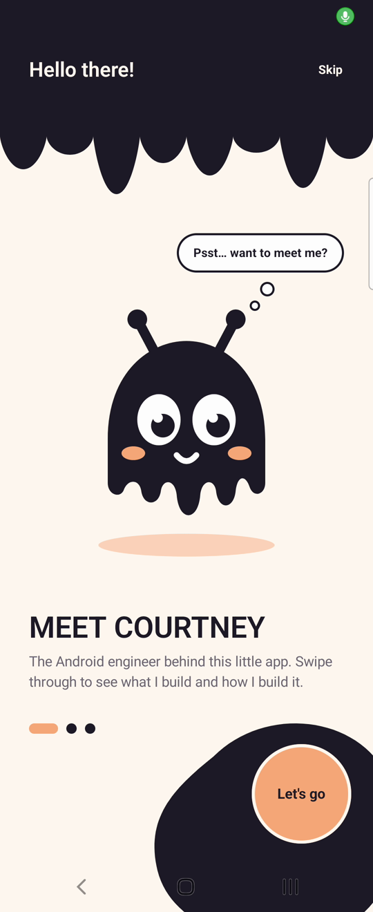
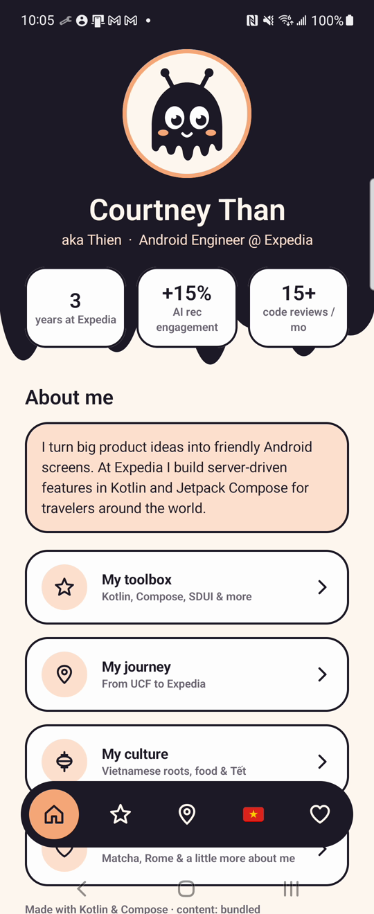
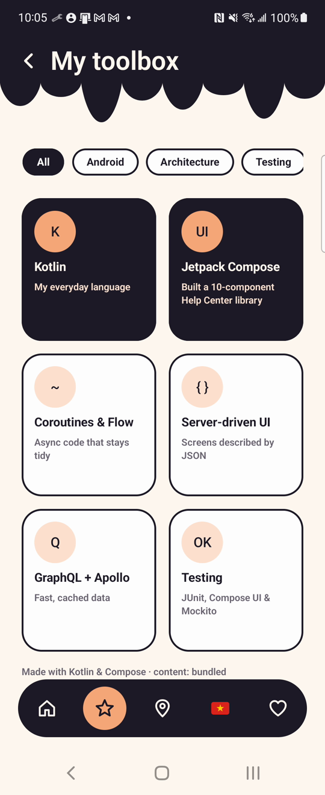
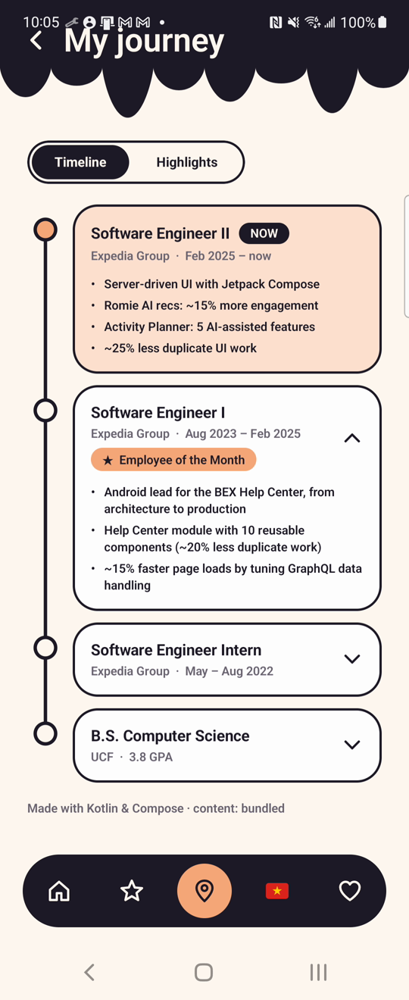
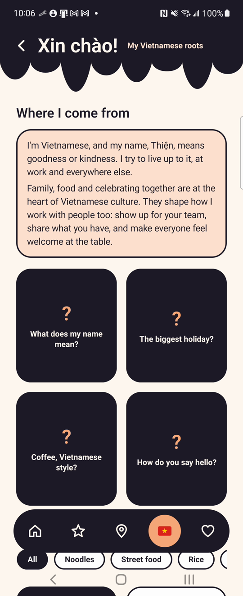
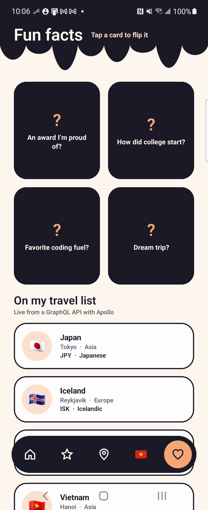

# Hi, I'm Courtney 👋

A cute little Android app that introduces me, and a small showcase of how I like to build Android apps.

Everything you see in the app (the welcome screen, the five tabs, every card and button) comes from **one JSON file** ([`profile.json`](app/src/main/assets/profile.json)) and is drawn at runtime by a tiny **server-driven UI (SDUI)** engine written in Kotlin and Jetpack Compose. Change the JSON on GitHub and the app updates itself, with no new release needed.

The UI was designed first in [Figma](https://www.figma.com/design/kwMbBvJQRsWkpjbLCwfbCV) (ink, cream and peach, drippy ink headers, and an original mascot named **Inky**) and then built to match, using the same color tokens, type ramp, icon paths and drip curves.

## Screenshots


|  |  |  |  |  |  |

Designed in [Figma](https://www.figma.com/design/kwMbBvJQRsWkpjbLCwfbCV) first, then built to match.

<!-- Optional: add a short screen recording at docs/demo.gif and uncomment:
<p align="center"></p> -->


## What's inside

| | |
|---|---|
| **UI** | 100% Jetpack Compose + Material 3, built from a Figma design system (tokens, components, custom `DripShape`, vector mascot), edge-to-edge |
| **Server-driven UI** | JSON → tabs → sealed `Section` types → Compose renderer. Server-defined **actions** (`open_tab`, `open_url`) and bottom-nav tabs. Safe fallbacks for unknown or broken sections |
| **Architecture** | Multi-module, unidirectional data flow (`ViewModel` → `StateFlow<UiState>` → stateless screen) |
| **Data** | Offline-first repository: bundled → cached → remote (stale-while-revalidate) |
| **REST + images** | Pexels photo search over OkHttp + kotlinx.serialization, images loaded and cached by Coil, API key kept out of git |
| **GraphQL** | Apollo Kotlin 4: schema + typed query codegen, normalized cache (memory + SQLite, `@typePolicy` keys), `CacheAndNetwork` |
| **Async** | Kotlin Coroutines & Flow (`flatMapLatest`, `stateIn`, `flowOn`, structured concurrency) |
| **DI** | Hilt |
| **Testing** | JUnit + Turbine unit tests, Apollo against MockWebServer, Compose UI tests, and a CI check that validates the content file |
| **Accessibility** | Headings for TalkBack, decorative emoji hidden from screen readers, state descriptions, respects "remove animations" |
| **CI** | GitHub Actions: unit tests, lint, debug APK, emulator UI tests |

## Fun things to try

- 👋 Inky bobs on the welcome screen (and holds still if you turn animations off in system settings).
- 🧰 Filter **My toolbox** by category.
- 🗺️ In **My journey**, tap a past role to expand it, or switch to **Highlights**.
- 🇻🇳 Open **Culture** (the flag tab) for my Vietnamese roots: flip the culture cards, filter Vietnamese dishes, and see Vietnam's details live over GraphQL. The whole tab is defined in `profile.json`, no new screen code.
- 🎀 Tap a **fun fact** card to flip it.
- 🌍 Scroll **Fun facts** to "On my travel list": live country data over GraphQL. Turn on airplane mode and reopen: it still shows, from Apollo's cache.

## Architecture

```
┌──────────────┐    ┌──────────────────────┐    ┌─────────────────────────────┐
│ :app         │───▶│ :feature:profile     │───▶│ :core:data                  │
│ Activity,    │    │ ProfileViewModel,    │    │ OfflineFirstProfileRepo     │
│ Hilt setup,  │    │ PlacesViewModel,     │    │  ├ bundled (assets)         │
│ profile.json │    │ SectionRenderer      │    │  ├ cache (filesDir)         │
└──────────────┘    └──────────┬───────────┘    │  └ remote (OkHttp)          │
                               │                │ ApolloPlacesRepository ─────┼──▶ Countries
                               ▼                │  └ normalized cache         │    GraphQL API
                    ┌──────────────────────┐    │    (memory + SQLite)        │
                    │ :core:designsystem   │    └──────────────┬──────────────┘
                    │ tokens, DripShape,   │                   ▼
                    │ Inky, InkCard, nav   │    ┌─────────────────────────────┐
                    └──────────────────────┘    │ :core:model (pure Kotlin)   │
                                                │ Tabs, Sections, Actions,    │
                                                │ Place, ProfileParser        │
                                                └─────────────────────────────┘
```

**How a screen gets drawn**

1. `OfflineFirstProfileRepository` emits the cached JSON (or the copy bundled in the APK) right away.
2. In the background it fetches `PROFILE_URL`. If that JSON parses **and** is different, it's cached and emitted.
3. `ProfileParser` decodes each section on its own. Unknown types or bad data become `Section.Unsupported`, so one broken block never breaks the screen.
4. `ProfileViewModel` maps this into `ProfileUiState` (`Loading` / `Content` / `Error`).
5. A `places` section only names countries; `PlacesViewModel` fetches their details over GraphQL with Apollo (cache first, then network).
6. The app shows the welcome screen, then the tabs. `SectionRenderer` turns each `Section` into a Compose component, in the order the JSON lists them. Taps run server-defined `Action`s.

🎨 **Design file:** [Hi, I'm Courtney – App UI on Figma](https://www.figma.com/design/kwMbBvJQRsWkpjbLCwfbCV): all five screens plus the components (Inky, chips, list row, button, bottom nav) and color/text styles the code mirrors.

Design decisions are written up in [`docs/adr`](docs/adr):
- [0001 – Server-driven UI with a sealed class registry](docs/adr/0001-server-driven-ui.md)
- [0002 – Fallbacks for unknown and broken sections](docs/adr/0002-section-fallbacks.md)
- [0003 – Offline-first content](docs/adr/0003-offline-first.md)
- [0004 – Layout from JSON, data from GraphQL](docs/adr/0004-layout-json-data-graphql.md)

## GraphQL + Apollo

The app uses a **hybrid SDUI** pattern, the same split many production apps use: `profile.json` decides the **layout** (which sections, in what order), and some sections fetch their **data** live over GraphQL.

The "On my travel list" section is the example. The JSON only names the countries:

```json
{ "type": "places", "id": "places", "title": "On my travel list",
  "countryCodes": ["JP", "IS", "IT", "VN", "GR"] }
```

Apollo then fetches each country's flag, capital, continent, currency and languages from the public [Countries GraphQL API](https://countries.trevorblades.com).

| File | Role |
|---|---|
| [`schema.graphqls`](core/data/src/main/graphql/schema.graphqls) | The schema (SDL) for the part of the API the app uses |
| [`Countries.graphql`](core/data/src/main/graphql/Countries.graphql) | The query. Apollo generates the type-safe `CountriesQuery` class from it at build time |
| [`extra.graphqls`](core/data/src/main/graphql/extra.graphqls) | Client-only rule: `@typePolicy(keyFields: "code")`, so the cache stores each country once (`Country:JP`) |
| [`PlacesRepository.kt`](core/data/src/main/kotlin/com/courtneythan/aboutme/core/data/PlacesRepository.kt) | Runs the query and maps Apollo's generated classes to the app's own `Place` model |
| [`DataModule.kt`](core/data/src/main/kotlin/com/courtneythan/aboutme/core/data/di/DataModule.kt) | Builds the `ApolloClient`: server URL, shared OkHttp client, memory + SQLite cache |
| [`PlacesViewModel.kt`](feature/profile/src/main/kotlin/com/courtneythan/aboutme/feature/profile/places/PlacesViewModel.kt) | Takes the codes from the JSON, exposes `Loading` / `Content` / `Error`, supports retry |

**What goes over the wire.** The codes are sent as GraphQL **variables**, separate from the query text, in an HTTP POST:

```json
{
  "operationName": "Countries",
  "variables": { "codes": ["JP", "IS", "IT", "VN", "GR"] },
  "query": "query Countries($codes: [String!]!) { countries(filter: { code: { in: $codes } }) { code name emoji capital currency continent { name } languages { name } } }"
}
```

**Caching.** Apollo's normalized cache (memory, backed by SQLite) is read with `FetchPolicy.CacheAndNetwork`:

- Saved places show instantly, even offline and after a restart. The network then refreshes them.
- A failed refresh keeps the saved copy on screen. With no cache and no network, the section shows an error card with **Try again**.
- A network problem only affects this section; the rest of the app is local content.

**Type safety.** The query is checked against the schema at build time, so a misspelled field fails the build, not the app. The UI depends on `Place`, never on generated classes, so changing the query doesn't ripple into Compose code.

**Try it:** change `countryCodes` in `profile.json` (ISO codes like `"FR"`) and run the app; no Kotlin changes needed. To pull the full, latest schema from the API:

```bash
./gradlew :core:data:downloadCountriesApolloSchemaFromIntrospection
```

**Tests.** [`ApolloPlacesRepositoryTest`](core/data/src/test/kotlin/com/courtneythan/aboutme/core/data/ApolloPlacesRepositoryTest.kt) runs the real Apollo client against a local `MockWebServer`. It checks the variables sent, response parsing, ordering, the offline cache fallback and the error case. `PlacesViewModelTest` and `PlacesContentTest` cover the state and the UI.

More detail: [ADR 0004 – Layout from JSON, data from GraphQL](docs/adr/0004-layout-json-data-graphql.md).

## Photos from Pexels

Under "Vietnam at a glance", the Culture tab shows a swipeable row of Vietnam photos from [Pexels](https://www.pexels.com). A photos section can get its photos three ways:

```json
{ "type": "photos", "id": "vietnam-photos", "items": [
  { "imageUrl": "https://images.pexels.com/photos/20224478/pexels-photo-20224478.jpeg?auto=compress&cs=tinysrgb&w=1260",
    "pageUrl": "https://www.pexels.com/photo/square-in-front-of-binh-tay-market-20224478/",
    "photographer": "Tuan Vy", "photographerUrl": "https://www.pexels.com/@tuan-vy-903011268/",
    "alt": "The Binh Tay Market entrance with trees and flags in Ho Chi Minh City" } ] }
{ "type": "photos", "id": "picked",  "photoIds": [20224478, 14025217] }
{ "type": "photos", "id": "search",  "query": "Hoi An", "count": 6 }
```

- **`items`** (what the app uses today): each photo spelled out in the JSON, including its credit. Images load straight from Pexels' public image links, so **no API key** is needed. This exists because Pexels has paused new API keys.
- **`photoIds`** and **`query`** call the [Pexels API](https://www.pexels.com/api/) for details and need a key (setup below). They're ready for when keys are available again.

A photo's ID is the number at the end of its Pexels URL, e.g. `pexels.com/photo/square-in-front-of-binh-tay-market-20224478/` → `20224478`.

- [`PhotosRepository.kt`](core/data/src/main/kotlin/com/courtneythan/aboutme/core/data/PhotosRepository.kt) uses OkHttp and kotlinx.serialization. Hand-picked photos are fetched in parallel with `GET /v1/photos/{id}` (order kept; a missing ID is skipped instead of failing the row), searches use `GET /v1/search`. Results are kept in memory to save the hourly request limit.
- [`PhotosSection.kt`](feature/profile/src/main/kotlin/com/courtneythan/aboutme/feature/profile/photos/PhotosSection.kt) loads images with **Coil** (cached on disk), shows the photo's average color while it loads, and uses each photo's `alt` text for screen readers.
- Following the Pexels guidelines, every photo credits its photographer ("Photo by …", linking to their profile), and the row ends with a "Photos provided by Pexels" link.

**API key setup (only for `photoIds` / `query`).** The key is read from `local.properties`, which git ignores, so it never lands in the repo:

1. Create a free account at [pexels.com](https://www.pexels.com/api/) and request an API key.
2. Add this line to `local.properties` in the project root:
   ```
   PEXELS_API_KEY=your_key_here
   ```
3. Sync Gradle and run.

Without a key (for example on CI), API-based photo sections show a friendly "add a key" card and everything else works; `items` sections always work. In a production app the key would live on a backend that calls Pexels for the app, since anything in an APK can be extracted.

## Make it yours: update the app without a release

1. Push this repo to GitHub.
2. In `app/build.gradle.kts`, set `PROFILE_URL` to the raw URL of your JSON:
   `https://raw.githubusercontent.com/CourtneyThan/CourtneyThan_Intro_App/main/app/src/main/assets/profile.json`
3. Install the app. Now edit `profile.json` on GitHub (reorder sections, add a fun fact) and reopen the app. ✨

### Content schema

```
{ "schemaVersion": 1,
  "welcome": { greeting, bubble, title, body, cta, skip? },        // optional
  "tabs": [ { "id", "label", "icon": home|star|map|lantern|heart|flag-vn, "sections": [ ... ] } ] }
```

Each section needs a `type` and an `id` that's unique within its tab.

| `type` | Fields |
|---|---|
| `hero` | `name`, `title`, optional `nickname`, `stats[]` of `{ value, label }` |
| `header` | `title`, optional `subtitle`, `showBack` (default true) |
| `about` | `title`, `paragraphs[]` |
| `link_list` | `links[]` of `{ title, subtitle, icon, action }` |
| `skills` | optional `title`, `allLabel`, `cards[]` of `{ glyph, title, caption, category, featured }` |
| `timeline` | `entries[]` of `{ role, company, period, highlights[], badge?, current }` |
| `fun_facts` | `facts[]` of `{ front, back }` |
| `photos` | One source: `items[]` of `{ imageUrl, pageUrl, photographer, photographerUrl, alt }` (no key needed), `photoIds[]` (Pexels API, in order), or `query` + `count` (Pexels search, default 6). Optional `title` |
| `places` | `title`, optional `subtitle`, `countryCodes[]` (ISO codes like `"JP"`; details come from GraphQL) |
| `contact` | `title`, `message`, `links[]` of `{ kind, label, url }` |

Actions: `{ "type": "open_tab", "tabId": "journey" }` or `{ "type": "open_url", "url": "https://…" }`.

Unknown fields are ignored. Unknown section or action types are skipped. A broken welcome block is dropped. `schemaVersion` above what the app supports is rejected and the last good content stays on screen.

## Run it

Requirements: Android Studio (Ladybug or newer), JDK 17.

```bash
git clone https://github.com/CourtneyThan/CourtneyThan_Intro_App.git
cd CourtneyThan_Intro_App
./scripts/download_fonts.sh  # Fredoka + Nunito (free, OFL). Optional: without them the system font is used
# Optional: add PEXELS_API_KEY=your_key to local.properties for the photo row
./gradlew installDebug       # run on a device or emulator
./gradlew test               # unit tests
./gradlew connectedCheck     # Compose UI tests (needs a device)
```

## What I'd add next

- Screenshot tests (Roborazzi or Paparazzi) for every section, compared against the Figma frames
- Gradle convention plugins to share module setup
- A Baseline Profile for faster startup
- Serve the layout itself over GraphQL too (one endpoint for layout + data), matching how I work day to day

## About me

I'm an Android engineer at Expedia Group, where I build customer-facing features with Kotlin, Jetpack Compose, GraphQL and server-driven UI.
[LinkedIn](https://www.linkedin.com/in/thien-than-006328195/) · [Email](mailto:courtthan@gmail.com)
