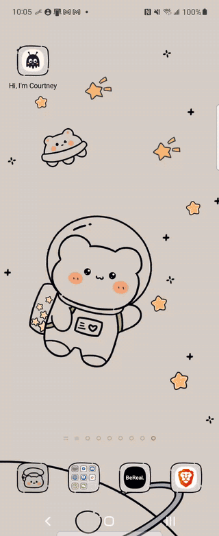

# Hi, I'm Courtney 👋

A cute little Android app that introduces me, and a small showcase of how I like to build Android apps.

Everything you see in the app (the welcome screen, the four tabs, every card and button) comes from **one JSON file** ([`profile.json`](app/src/main/assets/profile.json)) and is drawn at runtime by a tiny **server-driven UI (SDUI)** engine written in Kotlin and Jetpack Compose. Change the JSON on GitHub and the app updates itself, with no new release needed.

The UI was designed first in Figma (ink, cream and peach, drippy ink headers, and an original mascot named **Inky**) and then built to match, using the same color tokens, type ramp, icon paths and drip curves.

<!-- Add a screen recording here: docs/demo.gif -->
<p align="center"></p>


## What's inside

| | |
|---|---|
| **UI** | 100% Jetpack Compose + Material 3, built from a Figma design system (tokens, components, custom `DripShape`, vector mascot), edge-to-edge |
| **Server-driven UI** | JSON → tabs → sealed `Section` types → Compose renderer. Server-defined **actions** (`open_tab`, `open_url`) and bottom-nav tabs. Safe fallbacks for unknown or broken sections |
| **Architecture** | Multi-module, unidirectional data flow (`ViewModel` → `StateFlow<UiState>` → stateless screen) |
| **Data** | Offline-first repository: bundled → cached → remote (stale-while-revalidate) |
| **Async** | Kotlin Coroutines & Flow (`flatMapLatest`, `stateIn`, `flowOn`, structured concurrency) |
| **DI** | Hilt |
| **Testing** | JUnit + Turbine unit tests, Compose UI tests, and a CI check that validates the content file |
| **Accessibility** | Headings for TalkBack, decorative emoji hidden from screen readers, state descriptions, respects "remove animations" |
| **CI** | GitHub Actions: unit tests, lint, debug APK, emulator UI tests |

## Fun things to try

- 👋 Inky bobs on the welcome screen (and holds still if you turn animations off in system settings).
- 🧰 Filter **My toolbox** by category.
- 🗺️ In **My journey**, tap a past role to expand it, or switch to **Highlights**.
- 🎀 Tap a **fun fact** card to flip it.

## Architecture

```
┌─────────────┐     ┌────────────────────┐     ┌───────────────────────────┐
│    :app     │────▶│ :feature:profile   │────▶│ :core:data                │
│ Activity,   │     │ ViewModel, screen, │     │ OfflineFirstProfileRepo   │
│ Hilt setup  │     │ SectionRenderer    │     │  ├ bundled (assets)       │
└─────────────┘     └─────────┬──────────┘     │  ├ cache  (filesDir)      │
                              │                │  └ remote (OkHttp)        │
                              ▼                └────────────┬──────────────┘
                    ┌────────────────────┐                  ▼
                    │ :core:designsystem │     ┌───────────────────────────┐
                    │ theme, CuteCard,   │     │ :core:model (pure Kotlin) │
                    │ Pill, WavingEmoji  │     │ Section types, parser     │
                    └────────────────────┘     └───────────────────────────┘
```

**How a screen gets drawn**

1. `OfflineFirstProfileRepository` emits the cached JSON (or the copy bundled in the APK) right away.
2. In the background it fetches `PROFILE_URL`. If that JSON parses **and** is different, it's cached and emitted.
3. `ProfileParser` decodes each section on its own. Unknown types or bad data become `Section.Unsupported`, so one broken block never breaks the screen.
4. `ProfileViewModel` maps this into `ProfileUiState` (`Loading` / `Content` / `Error`).
5. The app shows the welcome screen, then the tabs. `SectionRenderer` turns each `Section` into a Compose component, in the order the JSON lists them. Taps run server-defined `Action`s.

Design decisions are written up in [`docs/adr`](docs/adr):
- [0001 – Server-driven UI with a sealed class registry](docs/adr/0001-server-driven-ui.md)
- [0002 – Fallbacks for unknown and broken sections](docs/adr/0002-section-fallbacks.md)
- [0003 – Offline-first content](docs/adr/0003-offline-first.md)

## Make it yours: update the app without a release

1. Push this repo to GitHub.
2. In `app/build.gradle.kts`, set `PROFILE_URL` to the raw URL of your JSON:
   `https://raw.githubusercontent.com/<you>/about-me-android/main/app/src/main/assets/profile.json`
3. Install the app. Now edit `profile.json` on GitHub (reorder sections, add a fun fact) and reopen the app. ✨

### Content schema

```
{ "schemaVersion": 1,
  "welcome": { greeting, bubble, title, body, cta, skip? },        // optional
  "tabs": [ { "id", "label", "icon": home|star|map|heart, "sections": [ ... ] } ] }
```

Each section needs a `type` and an `id` that's unique within its tab.

| `type` | Fields |
|---|---|
| `hero` | `name`, `title`, optional `nickname`, `stats[]` of `{ value, label }` |
| `header` | `title`, optional `subtitle`, `showBack` (default true) |
| `about` | `title`, `paragraphs[]` |
| `link_list` | `links[]` of `{ title, subtitle, icon, action }` |
| `skills` | `allLabel`, `cards[]` of `{ glyph, title, caption, category, featured }` |
| `timeline` | `entries[]` of `{ role, company, period, highlights[], badge?, current }` |
| `fun_facts` | `facts[]` of `{ front, back }` |
| `contact` | `title`, `message`, `links[]` of `{ kind, label, url }` |

Actions: `{ "type": "open_tab", "tabId": "journey" }` or `{ "type": "open_url", "url": "https://…" }`.

Unknown fields are ignored. Unknown section or action types are skipped. A broken welcome block is dropped. `schemaVersion` above what the app supports is rejected and the last good content stays on screen.

## Run it

Requirements: Android Studio (Ladybug or newer), JDK 17.

```bash
git clone https://github.com/YOUR_GITHUB_USERNAME/about-me-android.git
cd about-me-android
./scripts/download_fonts.sh  # Fredoka + Nunito (free, OFL). Optional: without them the system font is used
./gradlew installDebug       # run on a device or emulator
./gradlew test               # unit tests
./gradlew connectedCheck     # Compose UI tests (needs a device)
```

## What I'd add next

- Screenshot tests (Roborazzi or Paparazzi) for every section, compared against the Figma frames
- Gradle convention plugins to share module setup
- A Baseline Profile for faster startup
- Serve the layout from a GraphQL endpoint with Apollo, matching how I work day to day

## About me

I'm an Android engineer at Expedia Group, where I build customer-facing features with Kotlin, Jetpack Compose, GraphQL and server-driven UI.
[LinkedIn](https://www.linkedin.com/in/thien-than-006328195/) · [Email](mailto:courtthan@gmail.com)
